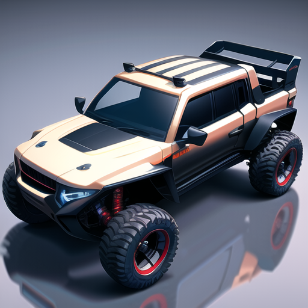
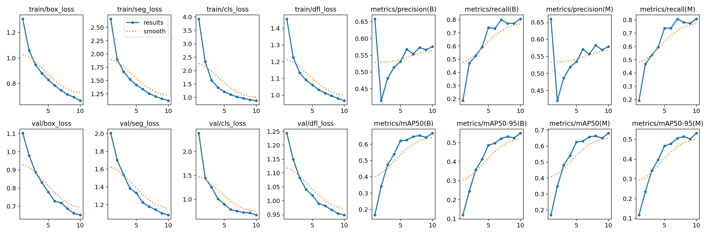

# CT3D: Text-to-Editable Part-Level 3D Industrial Generation Pipeline

CT3D is an automated web-driven 3D asset generation and part-segmentation pipeline for industrial design (demonstrated on vehicle concepts). Given a single text prompt, CT3D orchestrates **Stable Diffusion** (Text-to-2D), **Hunyuan3D-2.1** (Image-to-3D), **Blender orthographic multi-view rendering**, **YOLOv11-seg** wheel detection, and **3D ray-cast Boolean separation** to isolate editable mechanical components (such as wheels) from generated meshes.

> **Award**: Third Prize, *2025 Tianyuan Cup Intelligent Industrial Software Innovation Application Competition* (AI Track).

---

## Visual Pipeline Results

| 2D Concept Generation (`assets/2d_render.png`) | Multi-View Wheel Segmentation (`assets/2d_seg.png`) |
|---|---|
|  |  |

---

## Architecture

1. **Text-to-2D Concept Rendering (`Stable Diffusion WebUI`)**
   - Generates multi-candidate 2D vehicle renders via `--api` and stores selected PNG frames through `backend/image_store_server.py`.
2. **Image-to-3D Mesh Reconstruction (`Hunyuan3D-2.1`)**
   - Converts the selected 2D concept image into a textured `.glb` mesh via Hunyuan3D-2.1 API (`/generate`).
3. **Orthographic Multi-View Projection & YOLOv11-seg (`backend/segment_pipeline.py`)**
   - Imports the `.glb` mesh into Blender (`bpy`), renders canonical orthographic views (`FRONT`, `BACK`, `LEFT`, `RIGHT`, `TOP`, `BOTTOM` at `1920x1080`), and detects wheel segmentation masks using `weights/best.pt`.
4. **Ellipse Fitting & 3D Ray-Cast Separation (`backend/segment_pipeline.py`)**
   - Splits detected wheel coordinates along the median X axis, fits left/right ellipses (`cv2.fitEllipse`), casts rays into the Blender scene (`scene.ray_cast`), and separates wheel components via cylindrical Boolean intersection into `.blend` / `.glb`.
5. **Interactive Web Workbench (`frontend/index.html`)**
   - Unified browser interface featuring prompt generation, `<model-viewer>` interactive 3D preview, and part-segmentation upload/download.

---

## Repository Structure

```text
CT3D/
├── frontend/
│   └── index.html               # Web UI (Text->2D, Image->3D viewer, GLB->Segmented export)
├── backend/
│   ├── image_store_server.py    # Flask image store for PNG-to-URL relay (port 8547)
│   └── segment_pipeline.py      # Blender + YOLOv11-seg + 3D Boolean separation API (port 3546)
├── scripts/
│   ├── run_sd_webui.sh          # Launch script for Stable Diffusion WebUI API (port 7860)
│   ├── run_hunyuan3d.sh         # Launch script for Hunyuan3D-2.1 API server (port 8081)
│   └── test_hunyuan_api.py      # Reference API client for Hunyuan3D endpoints
├── weights/
│   └── best.pt                  # Trained YOLOv11-seg wheel segmentation weights
├── assets/
│   ├── 2d_render.png            # Sample 2D concept render
│   ├── 2d_seg.png               # Sample 2D wheel segmentation result
│   ├── sample_vehicle.glb       # Sample generated vehicle mesh
│   └── sample_wheel.glb         # Sample separated wheel mesh
├── requirements.txt
└── .gitignore
```

---

## Quick Start

### 1. Upstream Model Services

CT3D connects to two upstream open-source inference services:
- **Stable Diffusion WebUI**: clone [AUTOMATIC1111/stable-diffusion-webui](https://github.com/AUTOMATIC1111/stable-diffusion-webui) and run `scripts/run_sd_webui.sh` (port `7860`).
- **Hunyuan3D-2.1**: clone [Tencent-Hunyuan/Hunyuan3D-2.1](https://github.com/Tencent-Hunyuan/Hunyuan3D-2.1) and launch `api_server.py` via `scripts/run_hunyuan3d.sh` (port `8081`).

### 2. Image Store & 3D Segmentation Backends

```bash
pip install -r requirements.txt

# Terminal 1: 2D PNG relay server (default port 8547)
python backend/image_store_server.py

# Terminal 2: Blender + YOLOv11-seg segmentation API (default port 3546)
blender --background --python backend/segment_pipeline.py
```

### 3. Open the Frontend

Serve `frontend/` over HTTP (to satisfy browser CORS rules):

```bash
cd frontend
python -m http.server 8000
```

Open `http://127.0.0.1:8000/` in your browser. If your GPU backend runs on another host, update the **Backend Host** box directly in the web UI.
